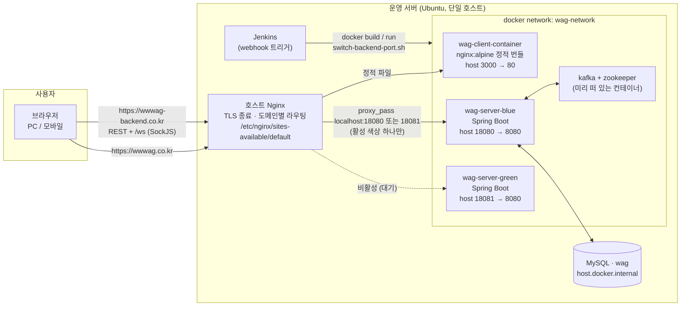
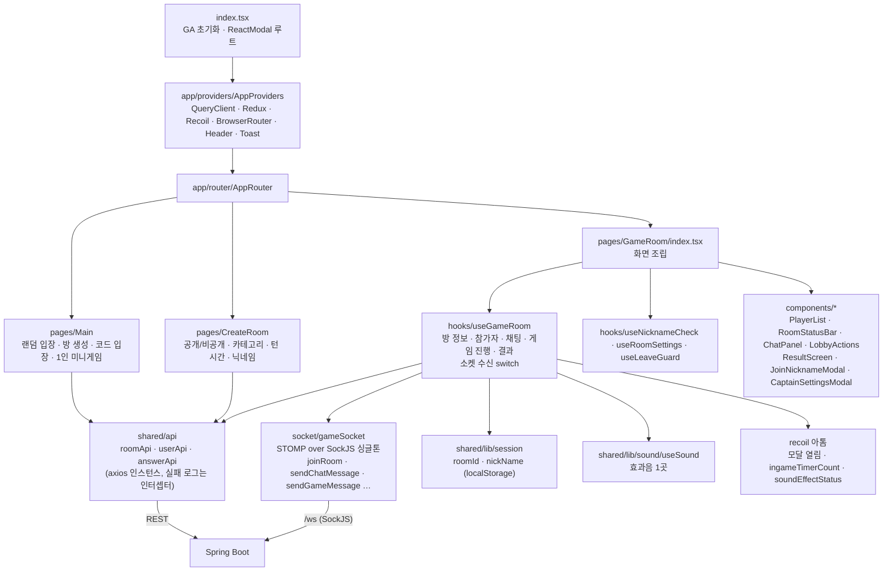
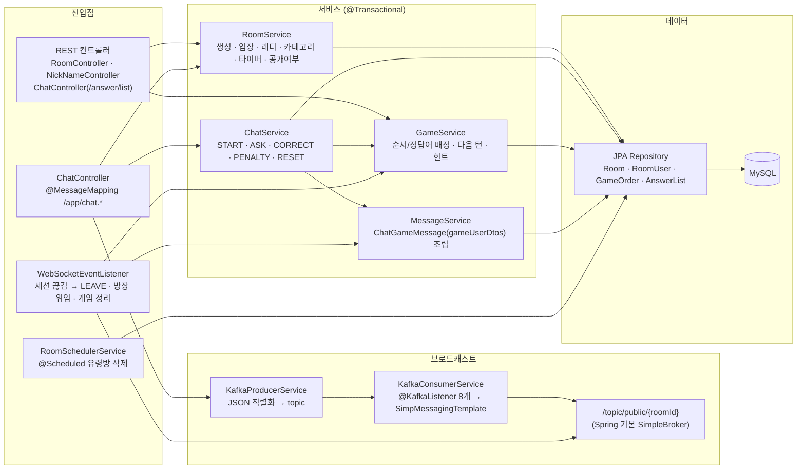
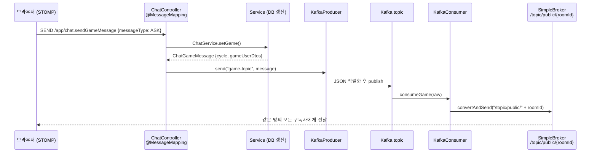
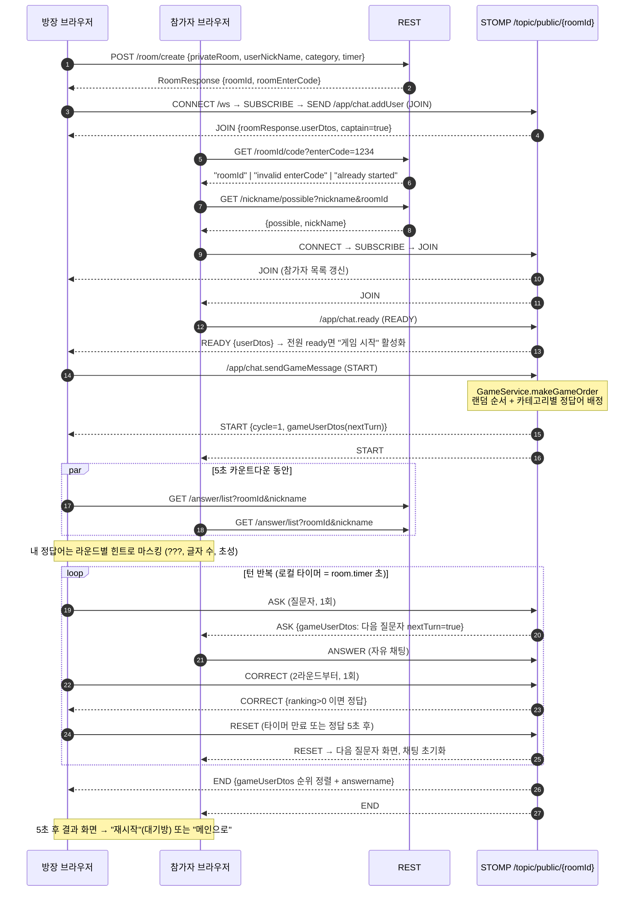
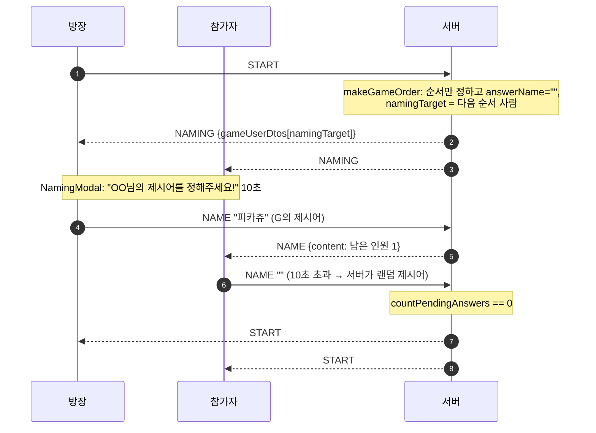
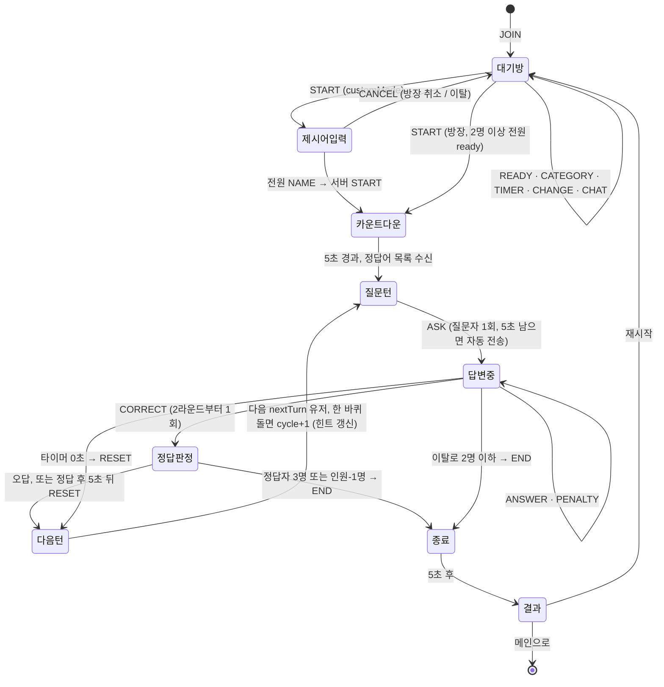
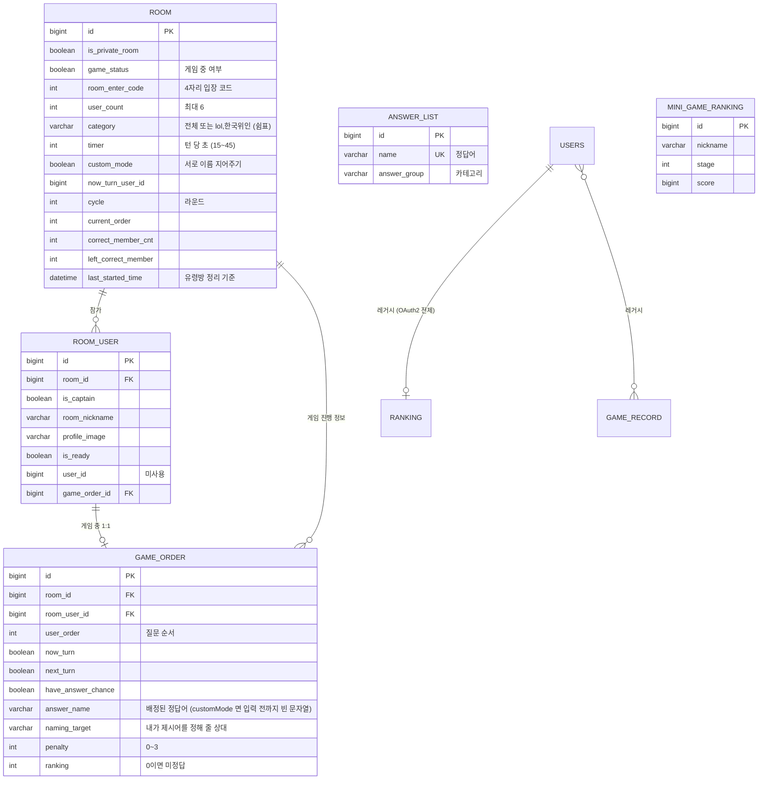
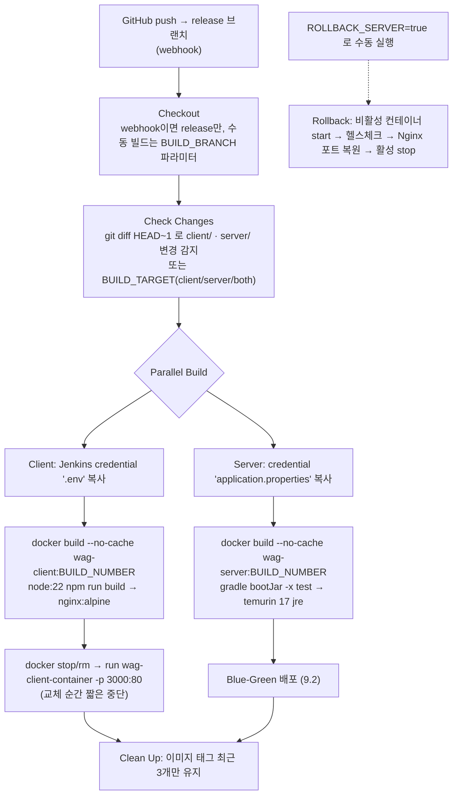
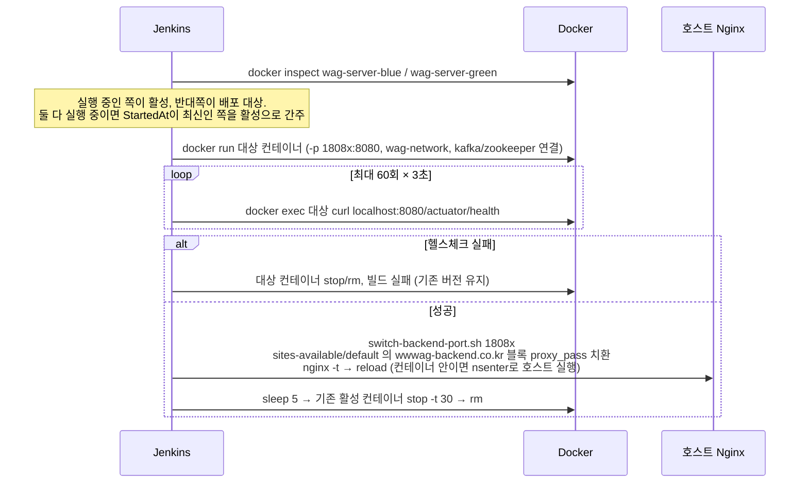

# WAG (양세찬 게임) 동작 · 배포 구조

> 기준: `develop` 브랜치, 커밋 `d3c738c` (2026-01-18) + 2026-10-16 리팩터링·UI 재설계 작업분(12·13장). 저장소의 클라이언트/서버/배포 코드를 전부 읽고 정리한 문서입니다.
> 도식은 모두 Mermaid 코드 블록이라 Notion, GitHub에서 그대로 렌더링됩니다.

## 1. 한눈에 보기

WAG는 **실시간 채팅 기반 양세찬 게임** 웹 앱입니다. 방을 만들고(또는 코드/랜덤으로 입장하고), 전원이 준비되면 서버가 각자에게 정답어를 배정하고, 턴마다 질문자 1명이 질문 → 나머지가 답변 → 질문자가 정답을 맞히는 흐름을 반복해 순위를 가립니다.

| 영역 | 기술 | 비고 |
| --- | --- | --- |
| 프론트엔드 | React 18, TypeScript 4.9, CRA(react-scripts 5), Tailwind 3 | 상태: Recoil(모달·타이머·효과음), Redux Toolkit(다크모드) |
| 실시간 통신 | STOMP over SockJS (`@stomp/stompjs`, `sockjs-client`) | 구독 토픽 `/topic/public/{roomId}` |
| 백엔드 | Spring Boot 3.0.5, Java 17, Spring Data JPA, Spring WebSocket, Spring Kafka, Spring Security, Actuator, springdoc | Gradle 빌드 |
| 데이터 | MySQL 8 | `ddl-auto=update`, 정답어 테이블은 수동 시드 |
| 메시지 브로커 | Kafka (+ Zookeeper) | 소켓 메시지를 Kafka로 한 번 거쳐 브로드캐스트 |
| 배포 | Jenkins 파이프라인 → Docker 이미지 → 단일 Ubuntu 호스트, 호스트 Nginx(TLS) | 백엔드는 Blue-Green 무중단, 프론트는 컨테이너 교체 |
| 분석 | Google Analytics 4 (`react-ga4`) | 이벤트 목록은 `client/src/shared/config/ga.ts` |

## 2. 시스템 구성도 (운영)



- 프론트는 빌드된 정적 파일만 서빙합니다. API 주소는 빌드 시 `.env`의 `REACT_APP_API_URL`(운영: `https://wwwag-backend.co.kr`)로 박힙니다.
- 백엔드 컨테이너는 Blue(18080)와 Green(18081) 중 하나만 트래픽을 받습니다. Jenkins가 새 버전을 반대쪽에 띄우고 헬스체크를 통과하면 Nginx의 `proxy_pass` 포트를 바꿔 전환합니다.
- MySQL은 컨테이너가 아니라 호스트(또는 외부)에 있고, 컨테이너는 `--add-host=host.docker.internal:host-gateway`로 접근합니다. 실제 접속 정보는 Jenkins credential로 주입되는 `application.properties`에만 있습니다.

## 3. 저장소 구조

```text
WAG/
├─ Jenkinsfile                 # CI/CD 파이프라인 (Blue-Green 함수 포함)
├─ switch-backend-port.sh      # 호스트 Nginx proxy_pass 포트 전환 (Jenkins가 호출)
├─ docker-compose.local.yml    # 로컬 개발용 MySQL + Kafka (이 문서에서 추가)
├─ design/figma/               # Figma 내보내기: README.md(화면별 색·폰트·텍스트 요약), frames.json, frames/*.png (화면별 PNG)
├─ scripts/
│  ├─ figma/                   # export-frames · export-nodes · describe-frame (FIGMA_TOKEN 필요)
│  ├─ notion/                  # publish-architecture (이 문서를 Notion 에 업로드, NOTION_TOKEN 필요)
│  └─ e2e/                     # smoke.mjs: 헤드리스 Chrome 2개로 게임 한 판 자동 검증
├─ client/                     # React 프론트엔드 (CRA)
│  ├─ Dockerfile               # node:22 빌드 → nginx:alpine 서빙
│  ├─ nginx/nginx.conf         # SPA fallback, 캐시, gzip
│  ├─ .env                     # REACT_APP_API_URL, REACT_APP_GA_TRACKING_ID (git 제외)
│  └─ src/
│     ├─ app/        providers(react-query·redux·recoil·router), router
│     ├─ pages/      Main, CreateRoom, GameRoom
│     │  └─ GameRoom/
│     │     ├─ index.tsx       화면 조립만 (약 150줄)
│     │     ├─ hooks/          useGameRoom(상태·소켓 전부), useNicknameCheck, useRoomSettings, useLeaveGuard
│     │     └─ components/     PlayerList·PlayerAvatar, TimerBar, RoomStatusBar, ChatPanel, LobbyActions,
│     │                        AnswerButton·AnswerModal(정답 모달), NamingModal(서로 이름 지어주기), ResultScreen,
│     │                        JoinNicknameModal, CaptainSettingsModal, LoadingSpinner
│     ├─ components/ layout(Header·Background·RulesModal·FullLayout), chatRoom, party, popover
│     ├─ shared/     api(axios 모듈 3개), config(API_URL·소켓 경로·GA 이벤트), lib(session·sound·viewport·category·GA),
│     │              ui(Button·IconButton·TextField·Toggle·RadioCard·Slider·MultiSelect·Modal·Toast·Wrapper)
│     ├─ socket/     gameSocket (STOMP 싱글톤), types(메시지 타입 유니온)
│     ├─ recoil/, modules/(redux), hooks/, types/(REST DTO), Game/(타이머, 준비/시작 버튼)
│     └─ Fonts/      Galmuri 픽셀 폰트
└─ server/                     # Spring Boot 백엔드
   ├─ Dockerfile               # gradle bootJar → temurin 17 jre
   ├─ docker-build.sh          # 로컬에서 서버 이미지 빌드/실행
   ├─ nginx-backend.conf, setup-nginx.sh, DEPLOYMENT.md   # upstream 방식 Nginx 안내 (현재 Jenkinsfile과는 다른 방식, 11장 참고)
   └─ src/main/java/com/example/server/
      ├─ config/      WebSocket, Security, CORS, Swagger, AppProperties
      ├─ controller/  Room, NickName, Chat(STOMP+REST), WebSocketEventListener, (MyPage·MiniGame·ChatGpt·User: 미사용)
      ├─ service/     Room, Chat, Game, Message, RoomScheduler, (NickName·MyPage·MiniGame·ChatGpt)
      ├─ kafka/       Producer, Consumer(→ SimpMessagingTemplate)
      ├─ domain/      Room, RoomUser, GameOrder, AnswerList, (User·Ranking·GameRecord·MiniGameRanking)
      ├─ repository/  JPA 리포지토리 (JPQL 다수)
      ├─ dto/, payload/, exception/, security/(JWT·OAuth2, 실질 미사용)
      └─ resources/application.properties   # git 제외, Jenkins credential로 주입
```

## 4. 프론트엔드 동작

### 4.1 화면과 라우트

| 경로 | 페이지 | 하는 일 |
| --- | --- | --- |
| `/` | `pages/Main` | 진입 시 `localStorage.clear()`. 랜덤 입장 / 방 생성 / 입장코드 입력(모달) / 1인 미니게임(외부 링크) |
| `/CreateRoom` | `pages/CreateRoom` | 공개·비공개, **서로 이름 지어주기** 토글(ON이면 카테고리 없음), 카테고리 **복수 선택**(`GET /categories`), 턴 시간(15~45초), 닉네임 → 방 생성 후 방장으로 입장 |
| `/GameRoom/:roomId` | `pages/GameRoom` | 대기방 → (서로 이름 지어주기: 제시어 입력 모달) → 게임 → 결과. 정답은 채팅창이 아니라 **정답 맞추기 모달**로 입력. 상태·소켓 처리는 `hooks/useGameRoom`, 화면은 `components/*`. `?code=1234`로 들어오면 코드 검증 후 입장 |
| 그 외 | `Navigate to="/"` | |

공통 레이아웃(`AppProviders`)에 Header(로고·효과음·BGM·규칙 모달·다크모드), 배경 장식(`Background`, Figma 의 흩어진 사각형), Toast 컨테이너가 있습니다. 반응형 기준은 Tailwind `sm`(640px)이고, 디자인 토큰(색·폰트)은 `client/tailwind.config.js` 에 Figma 값 그대로 정의되어 있습니다.

### 4.2 모듈 구조



### 4.3 상태 관리

| 저장소 | 내용 |
| --- | --- |
| Recoil | 모달 열림 여부 5종, 게임 중 타이머(`ingameTimerCount`), 효과음 on/off |
| Redux Toolkit | 다크모드(`dark.isDark`, `localStorage.theme`와 동기화) |
| `localStorage` | `roomId`, `nickName`(접근은 `shared/lib/session` 으로만), `theme`. 소켓 메시지를 보낼 때 sender/roomId를 여기서 읽음 |
| 훅 로컬 (`useGameRoom`) | 방 정보·참가자·레디·채팅·게임 진행·결과. 소켓 콜백은 항상 최신 렌더의 핸들러를 타도록 ref 로 감쌈 |
| react-query | Provider만 있고 쿼리는 사용하지 않음 |

### 4.4 페이지별 서버 호출

| 화면 | 호출 | 서버 | 응답 처리 |
| --- | --- | --- | --- |
| Main · 랜덤 입장 | `GET /roomId` | 공개·대기중·5명 이하인 방 중 랜덤 1개 | `"no available room"`이면 토스트, 아니면 `roomId` 저장 후 이동 |
| Main · 입장코드 | `GET /roomId/code?enterCode=` | 코드로 방 조회 | `"invalid enterCode"` / `"already started"` / `roomId` 문자열 |
| CreateRoom | `POST /room/create` | 4자리 코드 생성, 방 저장 | `roomId` 저장, `state.isCaptin=true`로 GameRoom 이동 |
| GameRoom 진입 | `GET /roomId/code` (code 쿼리 있을 때) | 위와 동일 | 실패 시 메인으로 |
| GameRoom 닉네임 모달 | `GET /nickname/possible?nickname=&roomId=` | 방 안 닉네임 중복 검사 | `possible`이면 "드가자" 활성화, `nickName` 저장 |
| CreateRoom · 방장 설정 모달 | `GET /categories` | 정답어 테이블의 카테고리 목록 | 복수 선택 드롭다운 옵션 (실패 시 기본 4개로 대체) |
| GameRoom JOIN/LEAVE/CHAT/CHANGE/READY 수신 시 | `GET /room/info?roomId=` | 방 정보 + 참가자 목록 | 입장코드·공개여부·카테고리·타이머·방장 여부 갱신 |
| GameRoom START 수신, 라운드 변경 시 | `GET /answer/list?roomId=&nickname=` | 참가자별 정답어 (내 것은 라운드별 힌트로 마스킹) | 질문자 정답어 표시, `PlayerList` → `JoinUser` 에 prop 으로 전달 (한 번만 호출) |

> 서버가 상태를 문자열(`"invalid enterCode"` 등)로 돌려주는 엔드포인트는 `roomApi` 가 `{ ok, roomId } | { ok: false, reason }` 로 바꿔 주므로 화면 코드는 문자열을 모릅니다.

### 4.5 소켓 클라이언트 (`socket/gameSocket.ts`)

- `joinRoom(onMessage)`: `new SockJS(API_URL + '/ws')` → `Stomp.over()` → connect → `/topic/public/{roomId}` 구독 → `/app/chat.addUser`로 `JOIN` 전송. 연결/구독은 싱글톤으로 1개만 유지합니다.
- 모든 송신 페이로드는 `{ sender: nickName, content, messageType, roomId }` 한 가지 형태이고, `sender`/`roomId`는 `localStorage`에서 읽습니다.
- 수신 콜백은 방 입장 시점에 한 번 등록되지만, `useGameRoom` 이 ref 로 감싸 항상 최신 핸들러가 실행됩니다. 메시지는 `socket/types.ts` 의 유니온 타입이라 `switch (message.messageType)` 에서 타입이 좁혀집니다(5.3 표 참고).
- 타이머는 서버가 아니라 **각 브라우저가 로컬로** 셉니다(`Game/timer/useTimer`). 질문자가 5초 남을 때까지 질문하지 않으면 자동으로 `ASK`를, 0초가 되면 `RESET`을 보내 턴을 넘깁니다.
- 반응형은 Tailwind `sm:` 접두사로 처리하고, 참가자 목록만 모바일에서 한 명씩 넘기는 자체 캐러셀(`PlayerList`)을 씁니다.
- 서로 이름 지어주기(`NAMING` 수신)면 `NamingModal`이 10초 타이머와 함께 뜨고, 입력하지 않아도 10초 뒤 빈 값을 보내 서버가 랜덤 제시어로 채웁니다.

## 5. 백엔드 동작

### 5.1 레이어 구조



### 5.2 REST 엔드포인트

| 메서드 | 경로 | 서비스 | 응답 | 클라이언트 사용 |
| --- | --- | --- | --- | --- |
| POST | `/room/create` | `RoomService.create` | `RoomResponse` (roomId, privateRoom, roomEnterCode, category, timer, customMode …) | ✅ CreateRoom |
| GET | `/room/info?roomId` | `RoomService.getRoomInfo` | `RoomResponse` + `userDtos[]` | ✅ GameRoom |
| GET | `/roomId/code?enterCode` | `RoomService.getRoomIdByEnterCode` | `"<roomId>"` / `"invalid enterCode"` / `"already started"` | ✅ Main, GameRoom |
| GET | `/roomId` | `RoomService.getRandomRoomId` | `"<roomId>"` / `"no available room"` | ✅ Main |
| GET | `/nickname/possible?nickname&roomId` | `NickNameService.settingNickName` | `{ possible, nickName }` | ✅ GameRoom |
| GET | `/answer/list?roomId&nickname` | `GameService.getAnswerList` | `{ answerUserDtos: [{nickname, answer}] }` | ✅ GameRoom |
| GET | `/categories` | `RoomService.getCategories` | `["lol", "한국위인", …]` (answer_list 의 distinct group) | ✅ CreateRoom, 방장 설정 |
| GET | `/actuator/health` | Actuator | `{status}` | Jenkins 헬스체크 |
| GET | `/swagger-ui.html` | springdoc | API 문서 | 개발용 |
| POST | `/chat-gpt/question` | `ChatGptService` (gpt-3.5-turbo) | | ❌ 미사용 |
| GET/PUT | `/ranking`, `/myPage`, `/user/me`, `/nickname` | MyPage·User·NickName | | ❌ 미사용 (OAuth2 로그인 전제) |
| POST/GET | `/ranking`, `/ranking/list` | `MiniGameService` | 1인 미니게임 랭킹 | ❌ 이 저장소 클라이언트는 미사용 |

보안 설정(`SecurityConfig`)은 `/**`를 `permitAll`로 열어 두어 JWT 필터·OAuth2 핸들러 코드는 남아 있지만 실질적으로 동작하지 않습니다. CORS 허용 오리진은 `app.cors.allowedOrigins` 프로퍼티로 주입됩니다.

### 5.3 STOMP 메시지와 Kafka 릴레이

클라이언트가 `/app/...`으로 보내면 컨트롤러가 DB를 갱신하고 결과 메시지를 Kafka 토픽에 넣습니다. `KafkaConsumerService`가 그 토픽을 구독해 `/topic/public/{roomId}`로 다시 흘려보내고, 같은 방을 구독 중인 모든 브라우저가 받습니다. (`WebSocketConfig`에 `enableSimpleBroker` 호출이 없지만 Spring이 기본 SimpleBroker를 자동으로 켜 주기 때문에 `/topic` 전달이 됩니다.)



| 송신 목적지 (`/app`) | messageType | 서버 처리 | Kafka 토픽 | 브로드캐스트 페이로드 |
| --- | --- | --- | --- | --- |
| `chat.addUser` | `JOIN` | `RoomService.enterRoomByRoomId` (첫 입장자가 방장, 6명 초과·게임중이면 예외), 세션에 username/roomId 저장 | `add-topic` | `ChatRoomInfoMessage` + `roomResponse(userDtos)` |
| `chat.sendMessage` | `CHAT` | 없음 (그대로 중계) | `chat-topic` | `ChatMessage` |
| `chat.ready` | `READY` | `RoomService.setReady` 토글 | `ready-topic` | `ChatReadyMessage` + `userDtos` |
| `chat.setCategory` | `CATEGORY` | 방장 검증, 존재하는 카테고리인지 검사 | `category-topic` | `ChatMessage(content=카테고리)` |
| `chat.setTimer` | `TIMER` | 방장 검증 | `timer-topic` | `ChatMessage(content=초)` |
| `chat.changeMode` | `CHANGE` | 공개↔비공개 토글 | `mode-topic` | `ChatRoomModeMessage(privateRoom)` |
| `chat.setCustomMode` | `CUSTOM` | 방장 검증, 서로 이름 지어주기 on/off (`content`="true"/"false") | `custom-topic` | `ChatMessage` |
| `chat.sendGameMessage` | `START` | `GameService.makeGameOrder` (전원 ready 검사, 랜덤 순서, 선택 카테고리들에서 정답어 배정), 방 상태 초기화. **서로 이름 지어주기면 정답어를 비워 두고 `NAMING`을 대신 보냄** | `game-topic` | `ChatGameMessage(cycle=1, gameUserDtos[namingTarget])` |
| | `NAME` | 보낸 사람이 맡은 상대(`namingTarget`)의 정답어 저장. 빈 값이면 랜덤 제시어. 방 행을 잠그고(`findByIdForUpdate`) 전원 입력이 끝나면 `START`, 아니면 남은 인원 수를 담은 `NAME` | `game-topic` | `ChatGameMessage` |
| | `CANCEL` | 방장만. 게임 순서 삭제, 방 상태 대기로 | `game-topic` | `ChatGameMessage(content=안내문)` |
| | `ASK` | 보낸 사람이 `nextTurn`이면 다음 질문자 계산, `currentOrder` 갱신 (아니면 `null` 전송) | `game-topic` | `ChatGameMessage` |
| | `ANSWER` | 그대로 중계 | `game-topic` | `ChatGameMessage` |
| | `CORRECT` | 정답 비교 → `ranking` 부여, 종료 조건이면 `END`로 바꿔 순위 정렬 전송 | `game-topic` | `ChatGameMessage` (`END`면 `answername` 포함) |
| | `PENALTY` | content=대상 닉네임, 경고 +1 (3 초과면 예외) | `game-topic` | `ChatGameMessage(content="… 경고를 받았습니다")` |
| | `RESET` | `nowTurnUserId`를 다음 질문자로 갱신 | `game-topic` | `ChatGameMessage` |
| (세션 끊김) | `LEAVE` / `END` / `ASK`·`RESET` / `CANCEL` | `WebSocketEventListener`: 인원 감소, 마지막 1명이면 방 삭제, 방장 위임, 게임 중이면 순서 재정렬·강제 턴 넘김. 제시어 입력 단계면 `CANCEL`로 단계 취소 | 없음 (`SimpMessagingTemplate` 직접) | `ChatRoomInfoMessage` / `ChatGameMessage` |

### 5.4 게임 규칙 로직

- **정답어 배정**: `START` 시 `RoomUser`를 랜덤 순서로 뽑고, 카테고리가 `전체`면 전체 테이블에서, 아니면 선택한 `answer_group`들(`"lol,한국위인"` 처럼 쉼표로 저장) 안에서 `ORDER BY RAND() LIMIT 6`으로 정답어를 뽑아 1:1로 `GameOrder`에 저장합니다. 인원보다 제시어가 적으면 `CategoryException`. 1번 순서가 첫 질문자(`nextTurn=true`)입니다.
- **서로 이름 지어주기**(`room.customMode`): 정답어를 비운 채 순서만 정하고, 각자 다음 순서 사람(`namingTarget`, 마지막은 첫 사람)의 제시어를 정합니다. `NAMING` → 각 클라이언트가 10초 안에 `NAME` → 전원 입력되면 서버가 `START`. 입력 중 누가 나가면 짝이 깨지므로 `CANCEL`로 대기방에 돌립니다.
- **내 정답어 힌트** (`GameService.getAnswerList`): 라운드(`room.cycle`) 1~2 → `???`, 3~4 → 글자 수만큼 `_`, 5~6 → 첫 글자 초성, 7 이상 → 두 글자 초성. 다른 사람 정답어는 그대로 보입니다.
- **턴 진행**: `ASK`를 받으면 `getNextTurn`이 아직 정답을 못 맞힌(`ranking=0`) 다음 순서를 찾고, 한 바퀴 돌면 `cycle`을 +1 합니다. `RESET`은 클라이언트 타이머 만료(또는 정답 후 5초)에 질문자가 보내며, 모든 클라이언트가 이를 받고 다음 턴 화면으로 넘어갑니다.
- **정답**: 질문자만 `CORRECT`를 보낼 수 있고(클라이언트에서 2라운드부터 허용), 맞히면 `correctMemberCnt` 순서가 곧 순위입니다. 정답자가 3명이 되거나 `인원-1`명이 맞히면 `END`.
- **경고**: 게임 중 다른 참가자의 아바타를 눌러 `PENALTY`를 보낼 수 있고, 경고 수는 아바타 옆 배지로 표시됩니다(규칙상 효과는 표시뿐).
- **이탈 처리**: 소켓이 끊기면 세션 속성(username, roomId)으로 유저를 찾아 삭제합니다. 방장이면 랜덤 위임, 게임 중이면 `GameOrder` 순서를 당기고 현재 질문자였다면 강제 `ASK`+`RESET`을 보냅니다. 남은 인원이 2명 이하가 되면 `END`.
- **유령방 정리**: `RoomSchedulerService`가 cron(`scheduler.room.check-ghost.cron`)마다 `lastStartedTime`이 `scheduler.room.lifetime.minutes`보다 오래된 방을 삭제합니다.

## 6. 게임 진행 시퀀스



### 6.1 서로 이름 지어주기 (customMode) 시작 시퀀스



## 7. 방 상태 전이



## 8. 데이터 모델



- 테이블/컬럼 이름은 Spring Boot 기본 네이밍 전략으로 camelCase → snake_case가 됩니다 (`answerList` → `answer_list`, `answerGroup` → `answer_group`).
- `ANSWER_LIST`는 코드에서 생성·시드하지 않습니다. 운영 DB에 직접 넣은 데이터이며 `data.sql`은 git에서 제외되어 있습니다. 카테고리마다 최소 6개가 있어야 6인 게임이 가능합니다.
- `USERS`, `RANKING`, `GAME_RECORD`, `MINI_GAME_RANKING`은 로그인/랭킹 기능 잔재로, 현재 게임 흐름에서는 쓰이지 않습니다.

## 9. 배포 파이프라인

### 9.1 흐름



### 9.2 Blue-Green 전환



### 9.3 컨테이너와 포트

| 이름 | 이미지 | 호스트 포트 → 컨테이너 | 비고 |
| --- | --- | --- | --- |
| `wag-client-container` | `wag-client:<BUILD_NUMBER>` | 3000 → 80 | nginx:alpine, SPA fallback, 해시 파일 1년 캐시 |
| `wag-server-blue` | `wag-server:<BUILD_NUMBER>` | 18080 → 8080 | JVM `-Xms512m -Xmx1024m -XX:+UseG1GC`, TZ Asia/Seoul |
| `wag-server-green` | `wag-server:<BUILD_NUMBER>` | 18081 → 8080 | 위와 동일 |
| `kafka`, `zookeeper` | (호스트에 미리 구성) | | Jenkins가 `wag-network`에 연결만 함 |
| 호스트 Nginx | 패키지 | 80/443 | `wwwag.co.kr` → 3000, `wwwag-backend.co.kr` → 1808x, `/ws` 업그레이드 |

### 9.4 비밀값 주입

- 프론트 `.env`와 백엔드 `application.properties`는 git에 없고 Jenkins **file credential**(`.env`, `application.properties`)에서 빌드 직전 복사됩니다. 둘 다 이미지 안에 구워지므로(프론트는 번들에 상수로, 백엔드는 JAR 리소스로) 값이 바뀌면 재빌드가 필요합니다.
- GitHub 체크아웃은 `credentialsId: 'gd10080008@gmail.com/******'`를 사용합니다.

### 9.5 롤백

`Build with Parameters`에서 `ROLLBACK_SERVER`를 켜면 빌드 없이 비활성 컨테이너(직전 버전, 이미지가 남아 있어야 함)를 `docker start`하고 헬스체크 후 Nginx 포트를 되돌립니다. 프론트는 롤백 단계가 없어서 이전 태그로 `docker run`을 직접 해야 합니다.

## 10. 로컬에서 실행하기

### 10.1 준비물

| 도구 | 버전 | 비고 |
| --- | --- | --- |
| Node.js | 20 이상 (운영 이미지는 22) | `client/` |
| JDK | 17 | `server/` (`./gradlew`가 Gradle 8.5를 내려받음) |
| Docker Desktop | 최신 | MySQL + Kafka를 컨테이너로 띄우는 용도 |

### 10.2 인프라 띄우기 (MySQL + Kafka)

저장소 루트의 `docker-compose.local.yml`을 사용합니다.

```bash
docker compose -f docker-compose.local.yml up -d
docker compose -f docker-compose.local.yml ps   # mysql(3306), kafka(9092) 가 healthy 인지 확인
```

> 로컬에 Homebrew MySQL이 돌고 있으면 3306 포트가 겹칩니다. `brew services stop mysql` 하거나 compose 파일의 포트를 바꾸세요.
>
> colima 처럼 `docker compose` 플러그인이 없는 환경이면 `brew install docker-compose` 를 하거나, compose 파일의 `docker run` 주석을 그대로 실행하면 됩니다. colima 를 x86_64 에뮬레이션으로 쓰고 있으면 `mysql:8.0` 이미지가 "CPU does not support x86-64-v2" 로 죽으니 `mysql:5.7` 로 바꾸세요 (이 문서 검증도 그렇게 했습니다).

### 10.3 백엔드

1. 설정 파일 만들기 (git 제외 파일이라 예시를 복사해서 씁니다)

   ```bash
   cd server
   cp src/main/resources/application.properties.example src/main/resources/application.properties
   cp src/main/resources/data.sql.example src/main/resources/data.sql   # 정답어 시드 (최초 1회)
   ```

   `application.properties.example`에는 코드가 `@Value`로 요구하는 키가 전부 들어 있습니다. 하나라도 빠지면 기동에 실패합니다.

   | 키 | 설명 |
   | --- | --- |
   | `spring.datasource.*` | `jdbc:mysql://localhost:3306/wag?createDatabaseIfNotExist=true`, root / 빈 비밀번호 |
   | `spring.kafka.bootstrap-servers` | `localhost:9092` |
   | `app.cors.allowedOrigins` | `http://localhost:3000` (모바일 실기기 테스트면 LAN IP 오리진도 추가) |
   | `app.swagger.url` | `http://localhost:8080` |
   | `scheduler.room.lifetime.minutes`, `scheduler.room.check-ghost.cron` | 유령방 정리 주기 |
   | `gpt.api.key` | 미사용이지만 키가 있어야 빈 생성이 됨. 아무 값이나 |
   | `spring.jpa.defer-datasource-initialization=true` | Hibernate가 테이블을 만든 뒤 `data.sql`이 실행되게 함 |

2. 실행

   ```bash
   ./gradlew bootRun
   # 확인
   curl http://localhost:8080/actuator/health        # {"status":"UP"}
   open http://localhost:8080/swagger-ui.html
   ```

3. Docker로 서버만 띄우고 싶을 때: `server/docker-build.sh` (이미지 `wag-server:local`, 8080 포트). 이때 properties의 DB/Kafka 주소는 `host.docker.internal`로 바꿔야 합니다.

### 10.4 프론트엔드

```bash
cd client
npm install
printf 'REACT_APP_API_URL=http://localhost:8080\nREACT_APP_GA_TRACKING_ID=\n' > .env.local
npm start            # http://localhost:3000
```

- `.env.local`은 `.env`보다 우선하므로 운영 주소가 적힌 `.env`를 건드리지 않아도 됩니다. GA ID를 비우면 콘솔 경고만 나고 수집은 꺼집니다.
- HTTPS로 띄우려면(모바일 마이크·클립보드 등 테스트) mkcert로 만든 인증서를 두고 `HTTPS=true SSL_CRT_FILE=localhost+2.pem SSL_KEY_FILE=localhost+2-key.pem npm start`.
- 같은 네트워크의 휴대폰에서 보려면 `HOST=0.0.0.0 npm start` 후 `REACT_APP_API_URL`을 PC의 LAN IP로 바꾸고, 백엔드 `app.cors.allowedOrigins`에 `http://<LAN IP>:3000`을 추가합니다.

### 10.5 게임 한 판 돌려보기

1. 브라우저 A: `방 생성` → 닉네임 입력 → 대기방에서 입장코드 확인.
2. 브라우저 B(시크릿 창 또는 다른 브라우저, `localStorage`가 분리되어야 함): `입장코드 입력` → 닉네임 → `준비 완료`.
3. A에서 `게임 시작`. 5초 뒤 질문자에게 "당신은 질문자입니다" 토스트가 뜨면 정상입니다.
4. 서버 로그에 `KafkaConsumer 실패`가 찍히면 Kafka가 아직 안 떠 있거나 `bootstrap-servers`가 틀린 것입니다.

### 10.6 빌드 확인

```bash
cd client && npx tsc --noEmit && npm run build      # 타입 검사 + 번들
cd server && ./gradlew clean bootJar -x test        # JAR
```

### 10.7 E2E 스모크 테스트

서버(8080)와 프론트(3000)가 떠 있는 상태에서, 헤드리스 Chrome 두 개(PC 방장 + 모바일 참가자)로 방 생성 → 입장 → 채팅 → 레디 → 게임 → 경고 → 정답 모달 → 결과 → 재시작 → 서로 이름 지어주기까지 자동으로 돌립니다.

```bash
cd scripts/e2e && npm install && npm run smoke
# 스크린샷: scripts/e2e/shots/*.png, 콘솔 에러: shots/errors.txt
# 크롬 경로가 다르면 CHROME_PATH=... 로 지정
```

## 11. 읽으면서 발견한 이슈와 주의점

**배포 / 설정**

- `server/nginx-backend.conf` + `setup-nginx.sh` + `DEPLOYMENT.md`는 5000 포트 `upstream` 방식인데, 현재 `Jenkinsfile`은 호스트의 `sites-available/default`에서 `wwwag-backend.co.kr` 블록의 `proxy_pass`를 `sed`로 치환하는 `switch-backend-port.sh`를 씁니다. 둘 중 하나로 정리하는 것이 좋습니다.
- `application.properties`는 과거에 커밋됐다가 삭제된 이력이 있어(git log) 히스토리에 OAuth 클라이언트 시크릿·GPT 키가 남아 있습니다. 키 로테이션을 권장합니다.
- 프론트는 Blue-Green이 아니라 컨테이너 교체라 배포 순간 수 초의 404가 날 수 있습니다.
- Kafka/Zookeeper 컨테이너가 호스트에 미리 있어야 하고, 이름이 `kafka`, `zookeeper`로 고정되어 있습니다.

**백엔드**

- `MiniGameController`의 `@RestController("/mini")`는 경로가 아니라 빈 이름입니다. 실제 경로는 `/ranking`, `/ranking/list`.
- `RoomService.setTimer`가 타이머 값을 카테고리와 비교하는 죽은 검사가 있습니다.
- `ChatService.askHandler`는 질문자가 아닌 사람이 `ASK`를 보내면 `null`을 반환합니다. 예전에는 그 `null`이 Kafka로 가서 컨슈머 NPE가 났는데, `ChatController.sendGameMessage` 에 null 이면 보내지 않는 가드를 넣었습니다 (2026-10-16).
- `WebSocketConfig` 주석은 "SimpleBroker 제거"라고 되어 있지만 Spring 기본값으로 켜져 있고, 그 덕분에 `/topic` 전달이 됩니다.
- 보안 설정이 전부 `permitAll`이라 JWT/OAuth2 코드는 현재 죽은 코드입니다.

**프론트엔드**

- `shared/lib/history`의 별도 `createBrowserHistory` 인스턴스는 `BrowserRouter`와 연결되어 있지 않아 뒤로가기 방지 로직(`useLeaveGuard`)이 의도대로 동작하지 않습니다.
- 새로고침하면 세션(소켓)이 끊겨 방에서 나가며, 방장이 혼자일 때 새로고침하면 방이 삭제됩니다(코드 내 TODO).
- `client/setupProxy.js`는 CRA가 읽는 위치(`src/`)가 아니고 내용도 비어 있습니다.
- 다크모드는 Redux, 모달은 Recoil, react-query 는 Provider만 있는 식으로 상태 라이브러리가 섞여 있습니다. UI 재설계 때 하나로 정리할 만합니다.

## 12. 변경 이력 (2026-10-16, 이 문서 작성과 함께 적용)

**프론트엔드 API 호출부 정리**

- `shared/api/*`: 모듈마다 반복되던 try/catch·console.error 를 axios 응답 인터셉터 한 곳으로 옮기고, 함수는 한 줄로 정리. 상태 문자열을 돌려주는 `/roomId`, `/roomId/code` 는 `RoomLookupResult` 유니온으로 변환. `getAnswerList`/`getGameAnswerList` 중복 제거.
- `shared/lib/session`: `localStorage` 의 `roomId`/`nickName` 접근을 한 곳으로. 메인 진입 시 `localStorage.clear()` 대신 게임 정보만 지워 다크모드 설정이 유지됨.
- `shared/lib/sound/useSound`: 페이지마다 복사돼 있던 효과음 함수 10여 개를 훅 하나로.
- `socket/types.ts`: 수신 메시지를 `messageType` 별 유니온 타입으로 정의해 `any` 제거. `gameSocket` 은 목적지별 메서드만 노출.

**GameRoom 분리** (1,500줄 → 조립 150줄 + 훅 4개 + 컴포넌트 9개)

- `useGameRoom`: 방 정보·참가자·채팅·게임 진행·결과 상태와 소켓 수신 `switch`. 콜백을 ref 로 감싸 오래된 클로저 문제 해결.
- `useNicknameCheck`, `useRoomSettings`, `useLeaveGuard` 로 입장 모달·방장 설정·이탈 방지 분리.
- 화면 조각은 전부 props 만 받는 컴포넌트라 Figma 디자인 적용 시 이 파일들만 바꾸면 됨.
- `JoinUser` 는 더 이상 API 를 호출하지 않고 정답어를 prop 으로 받음. `ChatRoom` 은 메시지 배열을 받아 그리기만 함.
- 함께 고친 동작: 정답 처리 시 질문자만 `ASK` 를 보내도록 수정(예전엔 전원이 보내 서버 NPE 유발), 자동 질문 후 질문 기회가 소진되도록 수정, 효과음 on/off 가 소켓 이벤트 소리에도 즉시 반영.
- 사용하지 않던 1,500줄 복사본 `Game/ReadyToGame.tsx` 와 미사용 recoil 아톰(`timerCount`, `firstCategoryRecoil`) 삭제.

**백엔드**

- `ChatController.sendGameMessage`: `null` 게임 메시지를 Kafka 로 보내지 않도록 가드.

**개발 환경**

- `docker-compose.local.yml`, `server/src/main/resources/application.properties.example`, `data.sql.example` 추가 (10장).
- `scripts/notion/publish-architecture.mjs` (이 문서를 Notion 페이지에 업로드), `scripts/figma/export-frames.mjs` (Figma 화면 PNG·텍스트·색상 추출) 추가.

## 13. UI 재설계 (2026-10-16, Figma "WAG Design" 반영)

Figma 파일의 `최종 디자인` 페이지(PC 1440×900 · 모바일 498×884, 라이트/다크)를 기준으로 화면을 다시 만들었습니다. 내보낸 자료는 `design/figma/` 에 있습니다 (README.md 에 화면별 색·폰트·텍스트, frames/ 에 화면별 PNG).

**디자인 시스템**

- 색·폰트 토큰: `client/tailwind.config.js` (`light.*`, `dark.*`, `wag.*`). Galmuri11 + 모바일 본문용 Galmuri14(OFL) 추가.
- 공통 UI (`client/src/shared/ui`): `Button`(menu·room·wide·modal·result·chip·setting 크기), `IconButton`(헤더 원형 45px·캐러셀 화살표), `TextField`, `Toggle`, `RadioCard`, `Slider`, `MultiSelect`(복수 선택 드롭다운), `Modal`(공통 오버레이, 5개 모달 컴포넌트를 대체).
- 배경 장식 `Background`, 헤더 `Header`(항상 표시), 본문 컬럼 `FullLayout`(PC 636px).
- 제거: react-modal·react-slick·react-dropdown·styled-components·material-tailwind 사용 코드, `JoinUser`/`RankingUser`/`ReadyStartButton`/모달 4종/`SquareBubble`.

**새 기능 (백엔드 포함)**

| 기능 | 프론트 | 백엔드 |
| --- | --- | --- |
| 서로 이름 지어주기 | 방 만들기·방장 설정 토글, `NamingModal`(10초), 대기방 "취소" 버튼 | `Room.customMode`, `GameOrder.namingTarget`, 메시지 `CUSTOM`/`NAMING`/`NAME`/`CANCEL`, `/app/chat.setCustomMode`, `custom-topic`, 입력 단계 이탈 시 취소 |
| 카테고리 복수 선택 | `MultiSelect`, "전체"는 빈 선택 | `category` 를 쉼표 목록으로 저장, `findAnswerListByGroups`, `GET /categories` |
| 정답 맞추기 모달 | `AnswerButton`(1라운드 잠금) + `AnswerModal`(남은 시간, 결과·등수 문구) | 변경 없음 (`CORRECT`/`END` 결과를 모달에 표시) |

**검증**: `scripts/e2e/smoke.mjs` 로 일반 모드(카테고리 2개)와 서로 이름 지어주기 모드를 끝까지 자동 실행, 콘솔 에러 0건.

**배포 시 주의**: `ddl-auto=update` 가 `room.custom_mode`(기본 false), `game_order.naming_target` 컬럼을 추가합니다. Kafka 에 `custom-topic` 이 자동 생성되어야 하므로 브로커의 `auto.create.topics.enable` 이 켜져 있어야 합니다(기존 토픽들도 같은 방식으로 생겼습니다).
